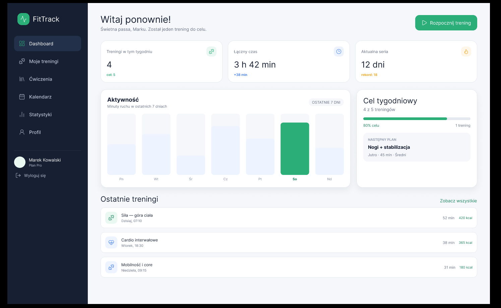
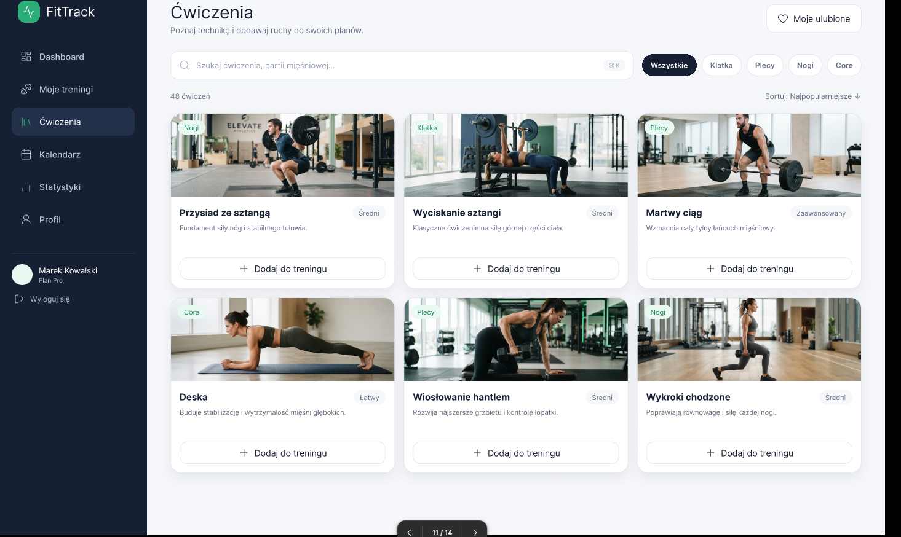
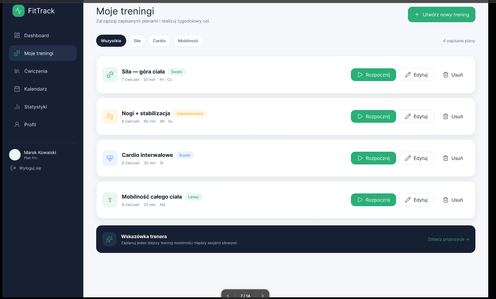
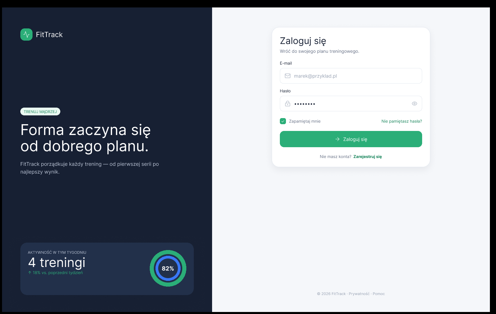

# Aplikacja treningowa

Aplikacja webowa umożliwiająca planowanie treningów, zapisywanie wyników oraz monitorowanie postępów użytkownika.

## Uruchomienie projektu

### Wymagania

Przed uruchomieniem projektu należy zainstalować:

- Node.js w wersji 20 lub nowszej (razem z npm),
- MySQL Server,
- opcjonalnie MySQL Workbench do wygodnego importu bazy danych.

### 1. Pobranie projektu i instalacja zależności

W terminalu przejdź do katalogu projektu, a następnie zainstaluj zależności frontendu i backendu:

```powershell
cd FitTrack
npm install

cd backend
npm install
cd ..
```

### 2. Przygotowanie bazy danych

Uruchom MySQL i utwórz bazę danych o nazwie `fittrack`. Następnie zaimportuj plik `backend/FitTrack.sql`.

Można to zrobić w MySQL Workbench:

1. Otwórz plik `FitTrack/backend/FitTrack.sql`.
2. Połącz się z lokalnym serwerem MySQL.
3. Wykonaj skrypt przyciskiem z ikoną błyskawicy.

Alternatywnie, w wierszu poleceń uruchom:

```text
mysql -u root -p -e "CREATE DATABASE IF NOT EXISTS fittrack;"
mysql -u root -p fittrack < backend/FitTrack.sql
```

Druga komenda powinna być uruchomiona z katalogu głównego projektu. Jeśli korzystasz z PowerShell i przekierowanie pliku nie działa, użyj importu w MySQL Workbench albo uruchom tę komendę w `cmd`.

### 3. Konfiguracja backendu

Utwórz plik `.env` na podstawie przykładowej konfiguracji:

```powershell
Copy-Item backend\.env.example backend\.env
```

Otwórz `FitTrack/backend/.env` i wpisz hasło do lokalnego użytkownika MySQL w `DB_PASSWORD`. Domyślna konfiguracja wygląda tak:

```env
PORT=3000
CLIENT_ORIGIN=http://localhost:5173
DB_HOST=localhost
DB_USER=root
DB_PASSWORD=twoje_haslo_mysql
DB_NAME=fittrack
```

### 4. Uruchomienie aplikacji

Uruchom backend i frontend w dwóch osobnych terminalach.

Terminal 1 — backend:

```powershell
cd FitTrack\backend
npm run dev
```

Terminal 2 — frontend:

```powershell
cd FitTrack
npm run dev
```

Po uruchomieniu otwórz w przeglądarce adres wyświetlony przez Vite, zazwyczaj:

```text
http://localhost:5173
```

Backend działa domyślnie pod adresem `http://localhost:3000`. Jego działanie można sprawdzić pod adresem `http://localhost:3000/health` — poprawna odpowiedź to `{"status":"ok"}`.

### Przydatne komendy

Komendy frontendu uruchamiane z katalogu `FitTrack`:

```powershell
npm run dev      # uruchomienie serwera deweloperskiego
npm run build    # zbudowanie wersji produkcyjnej
npm run preview  # podgląd zbudowanej aplikacji
npm run lint     # sprawdzenie kodu przez Oxlint
```

Komendy backendu uruchamiane z katalogu `FitTrack/backend`:

```powershell
npm run dev      # uruchomienie API
npm start        # uruchomienie API
```

Jeśli backend nie uruchamia się poprawnie, najczęstszą przyczyną jest niedziałający MySQL, brak bazy `fittrack` albo nieprawidłowe dane w pliku `backend/.env`.

## Zrzuty ekranu aplikacji

### Dashboard



### Ćwiczenia



### Moje treningi



### Logowanie




## Funkcje aplikacji

- rejestracja i logowanie użytkowników,
- tworzenie własnych planów treningowych,
- dodawanie ćwiczeń do treningu,
- zapisywanie liczby serii, powtórzeń i użytego ciężaru,
- oznaczanie treningu jako ukończonego,
- przeglądanie historii treningów,
- kalendarz aktywności,
- śledzenie postępów użytkownika,
- statystyki i wykresy,
- możliwość ustawiania celów treningowych,
- responsywny interfejs dostosowany do urządzeń mobilnych.

## Główne widoki

- strona główna,
- panel użytkownika,
- lista ćwiczeń,
- tworzenie planu treningowego,
- szczegóły treningu,
- historia aktywności,
- statystyki i wykresy,
- profil użytkownika.

## Przykładowe dane treningu

Każdy trening może zawierać:

- nazwę treningu,
- datę wykonania,
- listę ćwiczeń,
- liczbę serii,
- liczbę powtórzeń,
- ciężar,
- czas trwania,
- dodatkowe notatki.

## Technologie

- HTML,
- CSS,
- JavaScript,
- React,
- Node.js,
- Express,
- Mysql.


## Cel projektu

Celem projektu jest stworzenie prostej i intuicyjnej aplikacji pomagającej użytkownikom organizować treningi oraz analizować swoje postępy.

## Zakres projektu

### Wersja podstawowa — 4 tygodnie

- strona główna,
- lista ćwiczeń,
- tworzenie planów treningowych,
- zapisywanie wykonanych treningów,
- historia treningów,
- prosty profil użytkownika,


### Rozszerzenia — tygodnie 5–8

- rejestracja i logowanie,
- baza danych,
- kalendarz aktywności,
- statystyki i wykresy,
- cele treningowe,
- przypomnienia o treningach,
- gotowe plany treningowe,
- testy aplikacji,
- wdrożenie aplikacji,
- responsywny interfejs.

Projekt zostanie wykonany etapami. W pierwszej kolejności powstanie podstawowa, działająca wersja aplikacji, a następnie zostanie rozszerzona o dodatkowe funkcje.

## Status projektu

Projekt jest tworzony w ramach nauki programowania aplikacji webowych.
